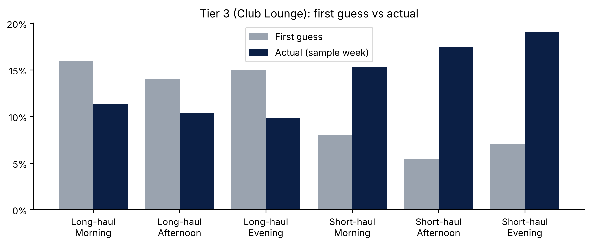

# Task 1: Lounge eligibility at Heathrow Terminal 3

BA wants to know how many passengers will be eligible for each of its lounges as schedules change. The goal was a lookup table that works with high-level flight groups rather than exact flights or aircraft.

| Tier | Lounge | Who can use it |
|---|---|---|
| 1 | Concorde Room | First Class, BA Premier cardholders, Gold Guest List |
| 2 | First Lounge | BA Gold members |
| 3 | Club Lounge | BA Silver cardholders, Club World customers |

There's no Concorde Room at Terminal 3 today, so Tier 1 is treated as hypothetical demand.

## Approach

1. **Grouped flights** by haul type (short or long) and departure time (morning, afternoon, evening), giving six groups. Both are known for any future schedule.
2. **Set first-guess assumptions.** I expected long-haul to have higher shares and mornings to peak.
3. **Tested them on a sample week** (14–20 July 2025, 312 flights). They didn't hold up: short-haul had higher shares, and time of day barely mattered.
4. **Revised the assumptions** using the full dataset, and checked whether region would help. It didn't, because region gives the same split as haul.
5. **Checked the final lookup** against all 10,000 flights.

## Final lookup table

| Group | Tier 1 | Tier 2 | Tier 3 |
|---|---|---|---|
| Long-haul – Morning | 0.2% | 2.8% | 10.6% |
| Long-haul – Afternoon | 0.2% | 2.7% | 10.5% |
| Long-haul – Evening | 0.2% | 2.7% | 10.3% |
| Short-haul – Morning | 0.3% | 4.4% | 16.7% |
| Short-haul – Afternoon | 0.4% | 4.4% | 16.8% |
| Short-haul – Evening | 0.3% | 4.5% | 17.0% |

Percentages are a share of all seats on a flight. Each passenger is counted once, in their highest tier.

**Accuracy:** on the sample week, estimated eligible passengers were within about 5% of actual for every tier. Across all 10,000 flights, they were within 2%.

## Why short-haul is higher

Short-haul aircraft are small (about 180 seats) and carry many frequent European business travellers, so status holders make up more of each flight. Long-haul aircraft have large economy cabins that are mostly leisure passengers.

## Limitations

Summer schedule only, no load factor (every seat is assumed filled), and no adjustment for connecting passengers or how long people stay in the lounge.

## Files

- `lounge_eligibility_analysis.ipynb`: the full analysis
- `Lounge_Eligibility_Lookup_Task_1.xlsx`: the submitted lookup table and justification
