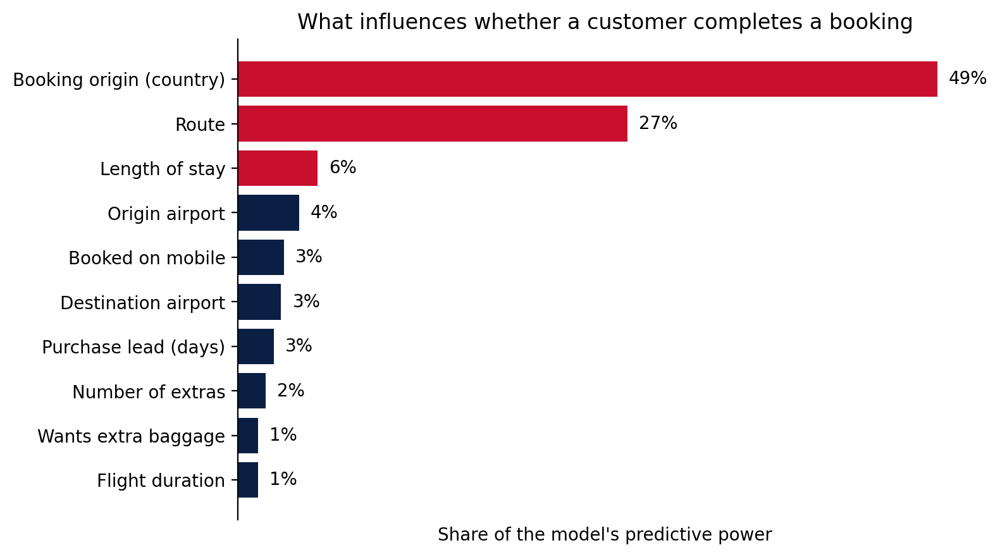
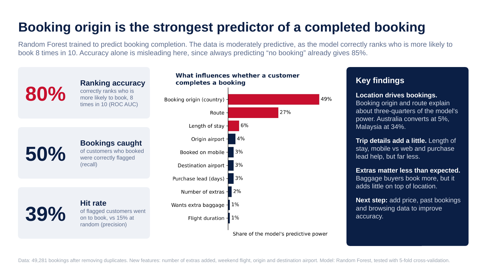

# Task 2: Predicting customer bookings

Can we predict whether a customer will complete a booking, and what drives that decision? I used 50,000 customer booking records to find out.

## Approach

1. **Explored the data.** Only 15% of customers complete a booking, so accuracy alone is misleading: always predicting "no booking" already gives 85%.
2. **Prepared the data.** Removed 719 duplicates, converted text columns to numbers, and target-encoded `route` and `booking_origin` inside the model pipeline to avoid leakage.
3. **Created new features:** number of extras chosen, weekend flight, and origin and destination airport split out from the route.
4. **Trained two Random Forests**, a default one and one balanced for the small number of completed bookings.
5. **Evaluated them** with stratified 5-fold cross-validation and a 20% hold-out test set.
6. **Explained the model** with permutation importance.

## Results (5-fold cross-validation)

| Model | Accuracy | Precision | Recall | F1 | ROC AUC |
|---|---|---|---|---|---|
| Always predict "no booking" | 0.85 | 0 | 0 | 0 | 0.50 |
| Default Random Forest | 0.85 | 0.47–0.50 | 0.11 | 0.18 | 0.79 |
| **Balanced Random Forest** | 0.81 | 0.39 | 0.48–0.50 | 0.43 | **0.80** |

The default model looks accurate but catches only about 11% of real bookings. The balanced model catches about half, and roughly 4 in 10 of the customers it flags go on to book, compared with a 15% base rate.

## Key findings

- **Location drives bookings.** Booking origin and route explain about three-quarters of the model's predictive power. Customers booking from Australia convert at about 5%, and from Malaysia at about 34%.
- **Trip details add a little.** Length of stay, mobile vs web and purchase lead help, but far less.
- **Extras matter less than expected.** Customers who add extra baggage book more often, but it adds little on top of location.
- **Next step:** price, past bookings and browsing data would probably improve the model a lot.

## Summary slide

## Notes

Results vary slightly between scikit-learn versions (for example, booking origin comes out at 49–51% of importance, and recall at 0.48–0.50). The submitted slide uses the numbers from my Colab run.

## Files

- `booking_prediction.ipynb`: the full analysis
- `BA_Booking_Prediction_Summary.pptx`: the submitted one-slide summary
